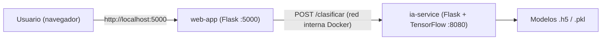

# 🧩 PrecentacionWEB – Portafolio Web + Servicio de IA (MicroServicios)

Este proyecto es un **portafolio personal web** construido con una **arquitectura de microservicios** usando **Flask** y **Docker**. Se divide en dos servicios independientes que se comunican por la red interna de Docker:

| Servicio | Carpeta | Tecnología | Puerto | Expuesto al host |
|---|---|---|---|---|
| `web-app` | [`WEB/`](WEB) | Flask + Jinja2 + Bootstrap 5 | `5000` | ✅ Sí (`localhost:5000`) |
| `ia-service` | [`AIFlask/`](AIFlask) | Flask + TensorFlow + scikit-learn | `8080` | ❌ No (solo red interna) |

---

## 📖 ¿De qué trata?

### 🌐 Aplicación Web (`web-app`)
Sitio de presentación personal con varias secciones:

- **Presentación** (`/`) – Sobre mí, habilidades y contacto.
- **Web** (`/Web`) – Tecnologías de desarrollo web.
- **Juegos** (`/Juegos`) – Desarrollo de videojuegos.
- **Hacking** (`/Hacking`) – Hacking ético y ciberseguridad.
- **Soporte** (`/Soporte`) – Soporte técnico.
- **Suma** (`/Suma`) – Demo de una suma procesada en el servidor vía AJAX (`POST /sumapy`).
- **Proyectos IA** (`/ProyectosIA`) – Permite subir una imagen y clasificarla con modelos de IA.

Características adicionales:
- 🌍 **Multi-idioma**: Español, Inglés y Ruso (`?lang=es|en|ru`, se guarda en sesión).
- 🌙 **Tema automático día/noche**: entre las 20:00 y las 06:00 se carga `styles-dark.css`.

### 🤖 Servicio de IA (`ia-service`)
Expone el endpoint `POST /clasificar`, que recibe una imagen (`file`) y el número de modelo (`modelo`). La web lo consume a través de `POST /clasificar_web`, que reenvía la petición a `http://ia-service:8080/clasificar`.

| `modelo` | Tipo | Archivo(s) | Clases |
|---|---|---|---|
| `1` | Clustering no supervisado (MobileNetV2 + K-Means, 15 clusters) | `modelo_extractor.h5`, `modelo_kmeans.pkl` | Pizza, Hamburguesa, Perro Caliente, Ilustración, Empaque, Foto con contexto |
| `2` | Transfer Learning (MobileNetV2) | `modelo_comidas.h5` | Hamburguesa, Perro Caliente, Pizza |
| `3` | CNN personalizada | `modelo_CNN.h5` | Babuino, Jirafa |



---

## 📁 Estructura del proyecto

```
PrecentacionWEB/
├── docker-compose.yml       # Orquestación de ambos servicios
├── .env                     # Variables de entorno (zona horaria)
├── .gitignore               # Ignora .venv/, __pycache__/, etc.
├── .gitattributes           # Modelos *.h5 gestionados con Git LFS
├── AIFlask/                 # Microservicio de Inteligencia Artificial
│   ├── app.py
│   ├── dockerfile
│   ├── requirements.txt
│   ├── modelo_CNN.h5        # ~510 MB (Git LFS)
│   ├── modelo_comidas.h5    # Git LFS
│   ├── modelo_extractor.h5  # Git LFS
│   └── modelo_kmeans.pkl
└── WEB/                     # Aplicación web (frontend + backend Flask)
    ├── app.py
    ├── dockerfile
    ├── requirements.txt
    ├── static/  (CSS, JS, img)
    └── templates/ (HTML Jinja2)
```

> [!NOTE]
> Las carpetas `.venv/` (entornos virtuales locales) no se incluyen en el repositorio; Docker instala las dependencias desde cada `requirements.txt`.

---

## ✅ Requisitos previos

- [Git](https://git-scm.com/downloads)
- [Git LFS](https://git-lfs.com/) (incluido en Git para Windows)
- [Docker Desktop](https://www.docker.com/products/docker-desktop/) (incluye Docker Compose v2)
- ~3 GB de espacio libre (la imagen de TensorFlow es pesada)

Verifica la instalación:

```bash
git --version
docker --version
docker compose version
```

---

## 🚀 Clonar y ejecutar

### 1. Instalar Git LFS (solo la primera vez)

Los modelos de IA (`*.h5`) se almacenan con [Git LFS](https://git-lfs.com/) porque `modelo_CNN.h5` pesa ~510 MB (GitHub no admite archivos normales de más de 100 MB).

```bash
git lfs install
```

### 2. Clonar el repositorio

```bash
git clone https://github.com/Absorbedfish/PrecentacionWEB.git
cd PrecentacionWEB
```

> [!IMPORTANT]
> Si Git LFS no estaba instalado al clonar, los `.h5` serán solo punteros de texto y el servicio de IA fallará. Soluciónalo con:
> ```bash
> git lfs install
> git lfs pull
> ```

### 3. Construir e iniciar los contenedores

```bash
docker compose up --build -d
```

- `--build` construye las imágenes a partir de los `dockerfile` de cada servicio.
- `-d` ejecuta los contenedores en segundo plano.

> La primera construcción puede tardar varios minutos porque se descarga e instala TensorFlow.

### 4. Abrir la aplicación

Visita en tu navegador: **http://localhost:5000**

---

## 🛠️ Comandos útiles

| Acción | Comando |
|---|---|
| Ver contenedores activos | `docker compose ps` |
| Ver logs de todos los servicios | `docker compose logs -f` |
| Ver logs solo de la IA | `docker compose logs -f ia-service` |
| Detener los servicios | `docker compose stop` |
| Detener y eliminar contenedores | `docker compose down` |
| Reconstruir tras cambios en el código | `docker compose up --build -d` |

Si todo está bien, en los logs de `ia-service` verás:

```
¡Modelos cargados exitosamente desde rutas absolutas!
```

---

## ⚙️ Configuración

- **Zona horaria**: definida como `America/Mexico_City` en `docker-compose.yml`, `.env` y los `dockerfile`. Afecta al tema día/noche de la web.
- **Puerto web**: para usar otro puerto en tu máquina, cambia la parte izquierda del mapeo en `docker-compose.yml`, por ejemplo `"8000:5000"`.
- **TensorFlow**: `TF_CPP_MIN_LOG_LEVEL=2` silencia las advertencias de CPU.

---

## 🧯 Solución de problemas

- **`port is already allocated`** → El puerto 5000 está ocupado; cámbialo en `docker-compose.yml` (ver arriba).
- **Error al clasificar imágenes** → Revisa `docker compose logs ia-service`; el servicio puede tardar unos segundos en cargar los modelos tras iniciar.
- **`ERROR CRÍTICO AL CARGAR MODELOS`** → Verifica que los archivos `.h5` y `.pkl` existan en `AIFlask/` (y que no sean punteros de Git LFS sin descargar).

---

## 👤 Autor

**Manuel Antonio** – [manuel138antonio@gmail.com](mailto:manuel138antonio@gmail.com)
